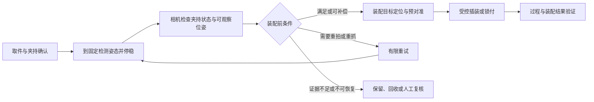

# 夹持后检测与装配前位姿复核：工艺可行性调研

日期：2026-10-31。状态：**调研完成，具体装配接口与 H1 实现方案尚未冻结；本轮未新增运行时代码或训练。**

用户最新澄清的用途是：机械臂夹起零件，保持在固定高度/检测位置，由相机确认方向姿态，满足条件后继续装配。本页据此调整后续重点；L1 来料检测分拣仍保留为已完成的开发分支，其连续扩线不再是默认下一步。方向决定见 [ADR-0003](../decisions/adr-0003-held-part-inspection-before-assembly.md)。

## 1. 结论

**工艺结构有工业依据，适合作为“抓取后复核、二次定位和装配前防错”研究。具体产线是否值得采用、能否直接投产仍需对象与工艺证据。**

相机可以检查夹持状态与可观察的姿态，必要时提供装配坐标补偿。它的通过结果应表示“满足已定义的装配前条件”，不能直接表示“装配已经成功”。固定高度有利于控制成像，但还需限定检测姿态、工作距离、光照、可见特征和夹爪位置。

本项目仍无具体真实零件/CAD、装配接口、公差与真实标定。现有 M3/M4/L1 开发成绩不转移为夹持后检测或装配成绩，真实协议与门禁保持原状态。

## 2. 一手资料与证据强度

| 来源 | 已核实内容 | 能支持的判断与限制 |
| --- | --- | --- |
| [S1 Mech-Mind：Pose Correction for Assembly](https://docs.mech-mind.net/en/suite-software-manual/latest/vision-steps/advanced-pose-transformation-pose-correction-for-assembly.html) | 技术手册明确描述抓取后到固定拍照点，再识别工件、修正装配 TCP/法兰目标；支持 2D/3D 和固定/非固定装配目标 | 与用户流程高度一致。手册要求一致的 TCP/示教及坐标转换；不证明本项目已具备相关精度 |
| [S2 Mech-Mind 社区：2D Secondary Positioning](https://community.mech-mind.com/t/topic/4680) | 杆类件抓取后，用固定 2D 相机检查空抓、反抓、多抓与偏差，并演示轴向补偿 | 官方社区内的具体实施技术贴，证据弱于产品手册/独立量产验收。方案的二维轮廓不包含真实 Z 高度；不能推广成任意 6D 恢复 |
| [S3 Cognex AlignPlus：Setup Examples，Assembly Guided Place](https://docs.cognex.com/apasap_431/web/EN/UserManual/Content/Topics/EOU/Wizard/Config/Setup%20Examples.htm) | 描述抓取后根据视觉计算的目标位姿调整机器人，再将两个部件装配 | 独立厂商的官方配置指南支持“抓取后视觉校正”的工艺类别；不是本项目实测 |
| [S4 WEBER：Fixtured Screwdriving Systems](https://www.weberusa.com/product-fixtured-screwdriving-systems) | 有机器人/轴系搭载的锁付主轴、自动送钉、真空保持及 pick-and-place 锁付路线 | 说明螺丝装配通常还要匹配专用锁付工具；夹取方案需要与送钉/锁付方案比较，不应预设额外举检总是最优 |
| [S5 UR：Tightening and torque check](https://video.universal-robots.com/tightening-and-torque-check) | 介绍带主轴、控制器、真空与送钉的方案，并具有漏钉/交叉螺纹检测功能 | 装配过程反馈和视觉姿态许可是不同环节；不将该产品参数复制成项目要求 |
| [S6 UR / Estic：Screwdriving Solution](https://video.universal-robots.com/estic-high-torque-screwdriving) | 工具用传感器与编码器记录扭矩、转角，并检测锁付缺陷 | 支持锁付质量需要过程测量，而不只依赖一张姿态图像 |
| [S7 UR：Force and Torque Control](https://docs.universal-robots.com/Universal_Robots_ROS_Documentation/rolling/doc/ur_robot_driver/ur_robot_driver/doc/usage/force_torque_control.html) | 官方驱动区分位置控制与笛卡尔力/力矩控制，可为选定轴配置柔顺行为 | 说明接触装配可使用独立的受控力/位置机制；具体任务的力限、传感精度和策略仍需验证 |
| [S8 NSK：Mounting](https://www.nskeurope.com/eu-en/tools-resources/maintenance/bearing-mounting/) | 轴承安装方法随配合而变，压装工具应按被装配的套圈正确施力 | “方向正确”不足以证明压装正确，还要明确配合、受力位置和到位条件 |

以上资料于本次调研核查。厂商案例的节拍、精度和商业宣传不作为本项目指标；“官方支持该流程”与“任意工况均已量产验证”分开。未据这些资料下单设备或确定供应商。

## 3. 对用户流程的工程解释

建议流程如下，**尚未实现**：

应分开三个输出：

| 层级 | 判断内容 | 允许得到的结论 |
| --- | --- | --- |
| 夹持状态/姿态检查 | 是否夹到、是否单件、头尾/端面是否符合、倾斜是否可判、是否滑移或夹偏 | 装配前检查结果与拒绝原因 |
| 二次定位/补偿 | 工件相对夹爪和装配目标的可测偏差，补偿后是否仍可达、可见、可夹持 | 装配目标修正或重抓建议 |
| 装配执行及质检 | 插入深度/力、压装曲线、锁付扭矩/转角、到位或连接完整性等 | 对应工艺的装配成功/失败 |

这一分层是本项目的工程建议。不能把 `INSPECTION_PASS` 自动等同于 `ASSEMBLY_SUCCESS`，也不能把“末端到达目标坐标”作为安装成功。

## 4. 固定高度应扩展为受控检测姿态

高度只约束一项。还应定义机器人检测位的平移/旋转、相机工作距离与成像区域、停稳条件、曝光/照明、关键特征可见性，以及夹爪是否遮挡这些特征。记录的是拍照时实际的机器人位姿和时间，而不仅是发送过的目标位姿。

具体需要核对：

- 夹爪夹在何处，是否挡住头部、端面、槽口、键槽或将要进入配合孔的区域；有些夹持方式需要换握或交给装配工具。
- 是否只有图像平面的方向要求，还是装配需要检测离面倾斜、深度/伸出量；一个固定高度不自动排除夹持偏移。
- 零件和夹爪的相对关系是否会在移动、停稳、拍照后继续改变。松夹、重抓、工具变更或可能滑移后，之前的放行结果应失效或复核。
- 检测位是否在原搬运路径上，以及新增的移动、停稳、曝光、处理、补偿和重试时间是否值得。先做停稳检测，再依据测量考虑路径内拍照；不复制案例中的处理耗时。

“机器人姿态已知”不等于“零件在夹爪中姿态已知”。可补偿的偏差不一定需要丢弃；但夹持不牢、关键面不可见或装配空间被夹爪挡住时，转动整个手腕并不会修复所有问题。

## 5. 相机与可观察性建议

| 方案 | 适合的首轮任务 | 主要限制 |
| --- | --- | --- |
| 固定侧视 RGB | 细长螺丝的头尾、轴线、伸出量/夹持偏移，前提是相关方向位于可观察平面 | 夹爪遮挡及离面倾斜；不能据此自动输出完整 6D |
| 固定上视或下视 RGB | 可见端面、孔槽/平面特征、平面内偏移 | 需按夹爪与安装方向选择视角；轴向深度/倾斜可能不可观察 |
| 两个标定视角 | 单视角无法区分的轴向倾斜或部分遮挡 | 标定、同步和可见特征要求增加；对称对象的绕轴角仍可能不唯一 |
| 3D/RGB-D | 需要真实空间位姿、多个自由度补偿且深度质量足够 | 细小反光件、遮挡和工作距离需实测；不是无条件优于受约束 2D |

建议先做可见性验证，再选相机数量。已有两点模型只能支持其声明的头尾/轴线任务；需要绕轴特征时，须有实际可见的不对称特征或按对称等价姿态评价。

S2 的二维案例只处理特定的平面/轴向补偿，其简化标定说法不等于所有任务都可以省去内参、TCP 和坐标关系检查。单 RGB 加固定高度可以支持受约束任务，不能借“转换成 3D Pose”这个接口名称冒充任意 6D 观测。

## 6. 装配目标和夹持偏差

以下是理想刚性、已标定且检测后不滑移条件下的工程关系，不代表现有模型已经输出完整矩阵。令 B 为机器人基座、C 为固定相机、G 为工具/TCP、O 为工件：

`T_G_O = inverse(T_B_G) × T_B_C × estimated(T_C_O)`

`T_B_G_target = desired(T_B_O) × inverse(T_G_O)`

固定夹具可以示教/标定装配目标；目标本身会变化时，应另行定位配合件/孔位。只看被夹零件，不能同时证明配合件的位置正确。2D 任务只补偿实际可观察且受约束的分量，缺少的自由度不得由对象 GT 填充。

一个几何示例说明旧角度阈值不可直接继承：若参考长度为 30 mm，1° 倾斜对应约 `30 × sin(1°) = 0.52 mm` 的横向量级。这只是几何示例，不是项目实物尺寸或公差；它说明分拣用的 10° 开发规则不能直接用作精密装配许可。

## 7. “装上”必须落实到具体工艺

| 候选对象 | 视觉能够帮助的环节 | 装配侧仍需定义 |
| --- | --- | --- |
| 螺丝 | 有无、单件、头尾、轴线与夹持偏差；具备特征时检查槽型相关方向 | 对孔、起扣、轴向进给与旋转工具；根据连接要求监测扭矩/转角/深度等。普通两指夹爪不能自动替代锁付主轴 |
| 轴承 | 型号/可辨端面、轴线、倾斜及抓取状态 | 配合是间隙还是过盈、压装工具施力套圈、到位和过程反馈；不能仅按方向图像批准压装 |
| 锥形齿轮 | 可见轴线、端面、轮毂或键槽等任务特征 | 具体轴孔/键槽/装配基准与配合关系；若涉及啮合，须另定义相应几何与工艺条件 |

该表是面向候选对象的条件分析，不把三个对象同时列为已选定实施任务。当前首轮对象仍为螺丝，型号/CAD 和具体装配接口没有自动冻结。

对于固定规格、大批量螺钉锁付，S4 展示的“自动定向送钉 + 锁付主轴”是应比较的替代工艺。**本报告的工程判断**：当抓取状态变化较大、工件混杂、换型频繁或装配失败代价高时，抓取后二次检测的价值更明确；若上料和工具已经充分约束姿态，额外夹爪举检的收益需要与节拍、换握和维护成本比较。不能只因能做出仿真就认定它是最优生产方案。

## 8. 与当前代码、数据的差距

本轮核对了实际实现：

| 已有能力 | 可复用部分 | 不可直接继承的部分 |
| --- | --- | --- |
| M3 头尾/轴线模型 | 模型框架、数据来源审计、训练/评价入口 | 训练主要来自固定桌面视角；没有验证夹爪背景、夹持遮挡及新的拍照视角 |
| M4 Panda | 物理夹持、搬运、相机渲染、分支对照与轨迹记录 | 视觉预测发生在抓取前；没有抓取后的视觉复核或装配许可 |
| L1 多帧事件 | 缺帧/一致性处理、唯一事件、拒绝和追溯思想 | 触发顺序与 GT 必须改为“本次抓取后的检查”；原来料方向 PASS 不能直接复用为装配许可 |
| `screw_proxy_v0` | 受约束头尾、可见轴线、简单接触研究 | 原代码明确为同心环视觉近似、光滑圆柱碰撞，没有真实螺旋螺纹；不能据此声称完成起扣/拧紧 |
| 当前目标工位 | 放置结果评价 | 现有目标是平面放置区域，没有配合孔/轴、真实间隙/过盈、装配工具及过程质检 |

核查入口：[螺丝几何](../../src/yolo_conveyor/simulation/screw_scene.py)、[M4 视觉与执行顺序](../../src/yolo_conveyor/simulation/closed_loop.py)、[搬运控制](../../src/yolo_conveyor/simulation/panda_control.py)、[L1 顺序](../../src/yolo_conveyor/line/runner.py)。旧结果仍有效于各自原范围，不能改写为本次新任务成果。

## 9. 推荐的 H1 研究顺序（待确认实现方案）

1. **确定装配任务**：螺丝是预定位后交给锁付工具，还是要求完整拧紧；或者实际目标改为轴承/齿轮装配。必须给出配合件/目标接口和需要检测的自由度，再定义“正确”。
2. **夹持可见性与工位设计**：在已有 Panda 上增加独立检测位，选择固定侧视/上视等视角，确认夹爪不遮住关键特征；先不扩连续输送线。
3. **夹持后数据与视觉基线**：增加正常、空抓、多抓、反抓、夹偏、倾斜、遮挡、滑移及图像异常等适用场景；按完整 grasp episode 隔离。对同样输入比较轮廓/模板方法与学习方法，不预设赢家。
4. **装配前门控**：视觉结果绑定本次 grasp ID、图像时刻、实际检测位姿和有效期；可信且满足已定义条件才许可下一步，可补偿偏差形成修正目标，不可判则有限重试或复核。
5. **具体装配分支**：确认接口后再实现对准、接触、插入/锁付与独立结果判定。若只做预插入示范，明确称为预插入，不能用平面落点成功代替装配成功。

仿真 GT 只用于监督和独立评分。视觉组不得读取真实工件—夹爪变换来生成补偿。评价至少区分：装配前误放/误拒与 Coverage、可观察位姿误差、新增节拍、重抓/复核比例、实际装配成功及卡滞/超力等适用结果。比例继续报告 x/n 与置信区间，数据/调参隔离规则沿用项目约束。

下一步关键输入是**具体装配接口及合格标准**，当前保持 TBD。相关公差、固定高度、力/扭矩阈值和样本规模不从本文示例或厂商案例自动填入真实协议。

## 10. 本轮交付边界

本轮完成公开一手资料调研、现有实现差距核查及路线纠正。没有新增夹持后模型、训练数据、装配运行时或量产验收结论；没有修改冻结的 M4/L1 代码与协议，也没有 Git commit / push。
